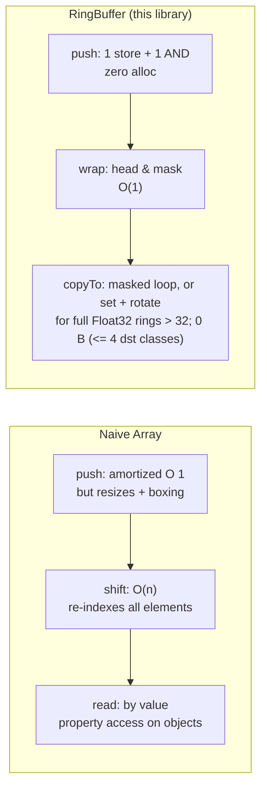
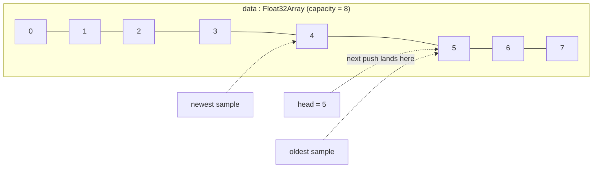
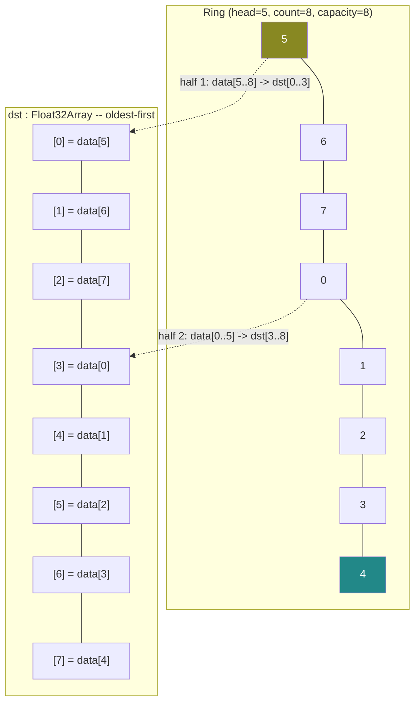
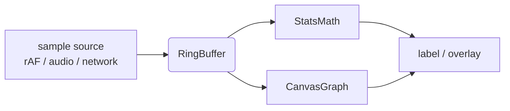

# @zakkster/lite-ring-buffer

[](https://www.npmjs.com/package/@zakkster/lite-ring-buffer)
[](https://github.com/sponsors/PeshoVurtoleta)

[](https://bundlephobia.com/result?p=@zakkster/lite-ring-buffer)
[](https://www.npmjs.com/package/@zakkster/lite-ring-buffer)
[](https://www.npmjs.com/package/@zakkster/lite-ring-buffer)


[](https://opensource.org/licenses/MIT)

**Pre-allocated, zero-GC circular buffer over a `Float32Array`. Power-of-two capacity. Mask-based wrap. Oldest-first bulk copy.**

One allocation for the lifetime of the buffer. No `Array.shift`, no slicing, no per-frame `new Float32Array`. The `push` hot path is one indexed store, a masked increment and a compare.

```js
import { RingBuffer } from '@zakkster/lite-ring-buffer';

const fps = new RingBuffer(1024);                  // -> capacity = 1024 (already a pow2)

// Hot path -- drop a sample every frame.
function onFrame(dt) {
  fps.push(1000 / dt);
}

// Read out the most recent sample.
fps.peekNewest();           // -> 60.0

// Bulk-copy the entire window into your renderer / stats engine.
const window = new Float32Array(fps.count);
fps.copyTo(window, 0);      // window[0] is oldest, window[count-1] is newest
```

---

## Contents

- [Why](#why) | [Install](#install) | [Quick start](#quick-start)
- [How it works](#how-it-works)
- [API reference](#api-reference)
- [Edge cases & guarantees](#edge-cases--guarantees)
- [Testing](#testing)
- [Companion libraries](#companion-libraries)
- [FAQ](#faq) | [License](#license)

---

## Why

You're sampling something -- frame times, audio levels, mouse velocity, network RTT -- and you want a sliding window of the last N values to render, average, or quantile.

The code you write first looks like this:

```js
// The first draft, and the version that bites you in production
const samples = [];
function pushSample(v) {
  samples.push(v);
  if (samples.length > 1024) samples.shift();   // O(n), per frame
}
```

Two problems compound at 60 fps:

1. `Array.shift()` is **O(n)** -- every frame you re-index 1023 elements just to drop the front one.
2. The array is a *generic* JS array. Each entry is a boxed double; growth and resize trigger fresh allocations and shape transitions; the GC sees a moving target.

`@zakkster/lite-ring-buffer` collapses both costs:



The buffer is a `Float32Array` so reads and writes are unboxed `number -> IEEE-754 float32` round trips -- the same memory representation a GPU vertex buffer or a `<canvas>` waveform expects.

---

## Install

```bash
npm i @zakkster/lite-ring-buffer
```

ESM-only. No dependencies. Ships TypeScript definitions alongside the source.

```js
import { RingBuffer } from '@zakkster/lite-ring-buffer';
```

You can also drop `RingBuffer.js` into your project directly -- it's one file with no imports.

---

## Quick start

### Telemetry window

```js
const frameTimes = new RingBuffer(512);

function tick(dt) {
  frameTimes.push(dt);
}

// Display the recent window in some UI.
function render() {
  const newest = frameTimes.peekNewest();
  const oldest = frameTimes.peekOldest();
  // ...
}
```

### Streaming into a stats engine

```js
import { RingBuffer } from '@zakkster/lite-ring-buffer';
import { StatsMath }   from '@zakkster/lite-stats-math';

const rb    = new RingBuffer(1024);
const stats = new StatsMath(rb.capacity);
const out   = { avg: 0, min: 0, max: 0, p01: 0, p99: 0 };  // hoisted, reused

function onSample(v) {
  rb.push(v);
}

function readout() {
  stats.compute(rb, out);
  return out;   // mutated in-place, no allocation per call
}
```

### Streaming into a `<canvas>` waveform

```js
import { RingBuffer } from '@zakkster/lite-ring-buffer';
import { CanvasGraph } from '@zakkster/lite-canvas-graph';

const rb = new RingBuffer(2048);
const graph = new CanvasGraph(canvas, 600, 200);

function frame(dtMs) {
  rb.push(dtMs);
  graph.render(rb, 33.34);   // expected max ~= 30 fps budget
  requestAnimationFrame(frame);
}
```

---

## How it works

### Power-of-two capacity -> bitmask wrap

The constructor rounds the requested capacity up to the next power of two:

| `requested` | `capacity` | `mask` |
|---:|---:|---:|
| 1 | 1 | 0 |
| 100 | 128 | 127 |
| 1024 | 1024 | 1023 |
| 1025 | 2048 | 2047 |

Wrap-around becomes `head = (head + 1) & mask` -- a single AND instead of a `%` modulo, which on V8 is roughly 3-5× cheaper in tight loops.

### Layout



Once the buffer is full (`count === capacity`), `head` chases the oldest sample around the ring. There is no "front pointer" -- the oldest is always at offset `(head - count + capacity) & mask`.

### Oldest-first bulk copy

`copyTo(dst, dstOffset)` writes oldest-first and allocates nothing at any size while its store sites stay within V8's 4-class feedback limit (see the allocation paragraph below). A full Float32 ring of more than 32 samples takes one `set` + `copyWithin` rotation plus a loop over the smaller ring half; every other copy (up to 32 samples, a partly filled ring, any Float64 `dst`) is a masked scalar loop. The diagram shows the two ring halves a copy has to place:



Allocation is DETERMINISTIC and gated: `npm run alloc` (inside `npm run verify`, 2026-11-12, Node v26.8.2 arm64) measures every gated `copyTo` lane, MEGA lanes included, at <= 0.2 B per call against a < 1 B per call gate. Each of `copyTo`'s three store sites (Float32Array `dst`, Float64Array `dst`, every other element type) allocates nothing until it has seen more than 4 distinct `dst` hidden classes in the process (each subclass, realm and resizable-buffer variant counts as one); past that the site boxes every non-integer sample (one HeapNumber per sample, 16 B on Node 26.8.2 arm64). `copyToFast` is unaffected. `npm run alloc` gates the family split (plus an Int16 must-allocate control) and REPORTS the 5-class Float32 residual. The alias check reads the `dst` buffer once per call; a small (<= 64 B) on-heap `dst` has its ArrayBuffer materialized by that read once (about 32-61 B off-heap per fresh small `dst`, REPORTED from the 2026-11-12 audit), so allocate and reuse `dst` rather than creating one per call. The cutoff of 32 (`COPY_LOOP_MAX`) is nominal. A `dst` that shares the ring's ArrayBuffer throws `RangeError` and writes nothing (1.2.1 silently corrupted a wrapped ring); `set` and `copyWithin` are the %TypedArray%.prototype intrinsics, so a `dst` subclass that overrides them cannot change the result. The scalar loop may quiet a signalling-NaN payload.

`copyToFast(dst, dstOffset)` keeps the 1.2.1 copy (at most two `set` calls over `subarray` views, a memcpy each) with identical validation and errors. It allocates 104 B per contiguous call and 208 B per wrapped call (REPORTED: `npm run alloc` lanes `copyToFast 1024, contiguous` / `wrapped`: 104.0 and 208.1 B/op, same run).

Timing is STATISTICAL and REPORTED, not gated (`npm run bench:copyto`, dev-only, strict quiet lock, not in `verify`, not shipped). One strict run 2026-11-12T06:10Z..06:14Z, Apple M4 Pro, Node v26.8.2 / V8 14.6.202.34-node.28, host QUIET (load1 2.74 at start, 1.54 at end, baseline 2.21), K 21 rounds x 3 compilations = 63 paired ratios per config, median per call vs 1.2.1 (43adb369) of the audit-fix build (c450e686): at n = 32 every layout is 1.47-1.52x slower (about 11 ns -> 16 ns); at n = 64 and 128 it is faster in every layout (0.26-0.89x); for a Float64 `dst` it is faster at every n >= 64 (0.26-0.62x at the medians); for a Float32 ring it is 1.29x (wrapped) / 1.34x (count n-1) slower at 256 and 3.03x (full, wrapped) / 3.85x (count n-1) slower at 1024. Use `copyToFast` when large wrapped or partly filled Float32 copies are hot and 104 / 208 B per call is acceptable.

| n | dst | layout | 1.2.1 ns | now ns | now / 1.2.1 (median) |
|---|---|---|---|---|---|
| 32 | f32 | contig / wrap / part | 10.8 / 10.8 / 10.5 | 16.3 / 16.3 / 16.0 | 1.51 / 1.51 / 1.52 |
| 32 | f64 | contig / wrap / part | 11.6 / 11.6 / 11.3 | 17.3 / 17.1 / 16.8 | 1.49 / 1.47 / 1.49 |
| 64 | f32 | contig / wrap / part | 29.3 / 54.6 / 54.9 | 15.0 / 37.9 / 25.6 | 0.51 / 0.69 / 0.47 |
| 64 | f64 | contig / wrap / part | 65.8 / 107.3 / 94.8 | 27.4 / 27.4 / 27.1 | 0.42 / 0.26 / 0.29 |
| 128 | f32 | contig / wrap / part | 31.6 / 59.1 / 58.4 | 17.5 / 52.2 / 44.6 | 0.56 / 0.89 / 0.77 |
| 128 | f64 | contig / wrap / part | 99.8 / 126.1 / 159.9 | 48.2 / 48.0 / 47.7 | 0.50 / 0.38 / 0.30 |
| 256 | f32 | contig / wrap / part | 36.0 / 62.0 / 62.1 | 21.2 / 79.6 / 83.0 | 0.59 / 1.29 / 1.34 |
| 256 | f64 | contig / wrap / part | 166.1 / 257.4 / 198.8 | 89.3 / 88.7 / 88.9 | 0.54 / 0.35 / 0.45 |
| 1024 | f32 | contig / wrap / part | 66.1 / 86.7 / 85.0 | 49.9 / 257.4 / 319.4 | 0.76 / 3.03 / 3.85 |
| 1024 | f64 | contig / wrap / part | 543.9 / 576.1 / 573.4 | 338.8 / 337.6 / 337.8 | 0.62 / 0.58 / 0.59 |

Layouts: contig = full ring, head 0; wrap = full ring, head n/2; part = count n-1, head n/2. Medians of 63 paired ratios per config; ns are medians per call. The per-config [Q1..Q3] ranges come from `npm run bench:copyto` (run under a strict quiet lock), which prints them. A/A medians in this run were 0.987..1.014 (the noise floor to read the ratios against). The audit-fix build against the previous build (63eb5bc1), same day, K 21 x 3, one quiet-lock hold, QUIET at hold start (load1 1.64; 4.40 at this run's start after the hold's earlier steps, 3.99 at end): TIE in 30 of 30 configs, medians 0.99-1.11x (n = 32: 1.09-1.11x; n >= 64: 0.99-1.07x).

Two consequences of the alias-check cache: the ring carries two enumerable own keys, `_bufOf` and `_buf` (they show in `Object.keys`, and `JSON.stringify` of a ring that has copied serializes its storage twice), and a replaced `data` (and its buffer) stays referenced until the next non-empty copy or `destroy()`; `reset()` does not release it. On a frozen, sealed or non-extensible ring the keys are never updated: the array cached before the lock stays referenced until `destroy()`, or for the ring's lifetime when frozen (`destroy()` throws a TypeError on a frozen ring, it cannot write it). `this.data` is read once per call, before the checks. Validation lives in a shared helper, so an error's stack has two extra frames vs 1.2.1 (the error builder and `copyCheck`); messages are unchanged.

---

## API reference

### `new RingBuffer(requestedCapacity = 1024)`

| Arg | Type | Description |
|---|---|---|
| `requestedCapacity` | `number` | Minimum capacity. Rounded up to the next power of two. |

Throws `RangeError` if `requestedCapacity` is not a number in `[1, 2^31]`. 2^31 is the ceiling because the wrap mask must fit in an int32. An argument that cannot be converted to text (a null-prototype object, an object whose `toString` throws) throws `TypeError` or the user's own error instead, before any state is written; a Symbol, BigInt or plain object still gets the `RangeError`. The same holds for a `dstOffset` passed to `copyTo` / `copyToFast`.

### Instance members

| Member | Type | Description |
|---|---|---|
| `requestedCapacity` | `number` (readonly) | What the caller asked for, before pow2 rounding. |
| `capacity` | `number` (readonly) | Actual storage size. Always a power of two. |
| `count` | `number` | Live samples, `0..capacity`. |
| `head` | `number` | Write cursor. Internal -- exposed for inspection only. |
| `mask` | `number` | `capacity - 1`. Used in the wrap math. |
| `data` | `Float32Array` | Backing storage. A shared empty `Float32Array` after `destroy()`. |

### Methods

| Method | Returns | Description |
|---|---|---|
| `push(value)` | `void` | Append a sample. Overwrites the oldest when full. The value is coerced like a typed-array store: `null`, `''` and `[]` store 0, `undefined` stores NaN (map missing readings to NaN yourself). **Hot-path safe.** |
| `tryPush(value, options?)` | `boolean` | Like `push`, but returns `false` when full and `options.overwrite === false`. Coerces the value like `push`. |
| `get(offset)` | `number \| undefined` | Sample at offset (0 = newest). `undefined` if out of range. |
| `getOrDefault(offset, default?)` | `number \| D` | Same, with a default for out-of-range (`undefined` when omitted). With a numeric default it allocates nothing in a hot loop; prefer it to `get`. |
| `peekNewest()` | `number` | Convenience for `getOrDefault(0, 0)`. |
| `peekOldest()` | `number` | Convenience for `getOrDefault(count - 1, 0)`. |
| `isFull()` | `boolean` | `count === capacity`. |
| `isEmpty()` | `boolean` | `count === 0`. |
| `copyTo(dst, dstOffset?)` | `number` | Write samples oldest-first into a `Float32Array` or `Float64Array`. Returns `count`. Allocates 0 B at every size until a store site has seen more than 4 `dst` hidden classes (then 16 B per non-integer sample; see Bulk copy). Throws `TypeError` if `dst` is not a TypedArray (or is a `BigInt64Array` / `BigUint64Array` that does not alias the ring and the buffer is not empty) and `RangeError` if it is too small, shares the ring's ArrayBuffer (an aliasing BigInt64Array / BigUint64Array `dst` gets this RangeError, not the TypeError), or (count > 0) the ring's `data` no longer holds `capacity` slots (replaced, resized or detached), writing nothing in any case. The alias check is ArrayBuffer identity: two SharedArrayBuffer objects over one memory block (a `structuredClone` or `postMessage` copy) are not detected; only a caller that replaced `data` with a view of shared memory can reach this. A frozen, sealed or non-extensible ring copies correctly (the cache is not stored, so each copy re-reads the buffer; the array cached before the lock stays referenced until `destroy()`, or for the ring's lifetime when frozen). |
| `copyToFast(dst, dstOffset?)` | `number` | Same result, validation and errors as `copyTo` (detached storage is the storage `RangeError`, not the V8 `TypeError` 1.2.1 threw); not affected by the 4-class limit; copies with at most two `set` calls over `subarray` views, so it allocates 104 B (contiguous) or 208 B (wrapped) per call. Faster than `copyTo` only for a wrapped or partly filled Float32 ring of 256+ samples (`copyTo` / `copyToFast` medians 1.18-1.20x at 256, 2.79-3.58x at 1024, 2026-11-12 run above); slower in every other measured cell. |
| `forEach(fn)` | `void` | Call `fn(value, index, rb)` for each sample, oldest-first. Zero allocation with a hoisted callback holds for ONE callback function per process: after a second distinct callback has been passed to any `forEach`, the call site is megamorphic and a non-inlined callback boxes each non-integer sample (about 128 B per 8-sample call, REPORTED from the 2026-11-12 audit, not gated). |
| `[Symbol.iterator]()` | `Iterator<number>` | `for (const v of rb)` / `[...rb]`, oldest-first. |
| `reset()` | `void` | Clear the buffer and zero the backing storage. |
| `destroy()` | `void` | Release the backing storage; `data` becomes a shared empty `Float32Array`. Subsequent calls are undefined behavior: `push`, `tryPush` and `reset` no longer throw, they do nothing. |

### Helpers

| Export | Description |
|---|---|
| `ceilPow2(n)` | Smallest power of two `>= n` for an integer `n` in `[1, 2^32]`. `ceilPow2(1) === 1`. Not validated: a fraction above 1 behaves as `Math.floor(n)` (`ceilPow2(1.5) === 1`); `0 < n < 1`, `NaN` and `+/-Infinity` give `1`; a finite `n` in `(-2^31, 0]` gives `2^32` (at or below `-2^31` the uint32 wrap of `n - 1` decides: `ceilPow2(-(2 ** 31)) === 2 ** 31`, `ceilPow2(-1e300) === 1`); `n > 2^32` wraps mod `2^32`. |
| `MAX_CAPACITY` | `2^31`, the largest accepted capacity. |

---

## Edge cases & guarantees

- **Capacity is always rounded up.** `new RingBuffer(100).capacity === 128`. The original is preserved on `requestedCapacity` so you can size sibling structures (e.g. a stats scratchpad) to either value as needed.
- **`get(0)` is the newest.** Any offset that is not an integer in `[0, count)` (negative, out of range, `NaN`, fractional, non-number) returns `undefined` (`get`) or the default (`getOrDefault`). They never throw.
- **NaN and +/-Infinity round-trip.** They store and read back unchanged. Downstream stats consumers must filter NaN themselves; `@zakkster/lite-stats-math` does this for you.
- **Finite values past the float32 range store as +/-Infinity.** A finite `x` with `|x| >= 2^128 - 2^103` (about 3.4028236e38, half a float32 ulp past the float32 max 3.4028234663852886e38) rounds to `+/-Infinity` on store; between the float32 max and that bound it rounds to the max. So `push(1e39)` stores `+Infinity` although `1e39` passes `v === v` and `Number.isFinite`: checking the input for NaN or finiteness does not predict the stored value. Clamp before `push`, or check what you read back.
- **`push` / `tryPush` coerce like a typed-array store.** `push(null)`, `push('')` and `push([])` store 0; `undefined` stores NaN; `'3'` stores 3; `true` stores 1; an object that converts to a non-number (`{}`) stores NaN; one that cannot be converted (a null-prototype object, a throwing `valueOf` / `toString`) throws that TypeError / the user's error and stores nothing. A missing reading is therefore 0 unless you map it to NaN yourself.
- **`tryPush` does not allocate when called without options.** The implementation reads the option object by property access (no destructuring default), so `tryPush(v)` is hot-path-safe just like `push(v)`.
- **`reset()` zeroes the backing memory.** The library's own reads are bounded by `count` and never see old slots; zeroing protects consumers that read `data` directly. The cost is one `Float32Array.fill(0)` (O(capacity)), which is a single memset in V8.
- **`destroy()` is final.** It swaps `data` for a shared empty `Float32Array` so the GC can reclaim the backing buffer in long-lived applications. It does not assign `null`: that would widen the `data` field's tracked type in V8 from `Float32Array` to any value for every live instance (seen with `--trace-generalization`, Node 26.8.2). The trade-off: `push`, `tryPush` and `reset` after `destroy()` used to throw a `TypeError` on `null`; now they do nothing, and `tryPush(v)` returns `true` without storing. Reads were already empty. After `destroy()`, the instance is unusable, and nothing tells you so.
- **Hot-path zero-allocation.** Measured by `npm run alloc` (`test/alloc.mjs`, V8's allocated-bytes counter, 1M calls per window, Node 26.8.2 arm64) in a monomorphic hot loop, with non-integer samples: `push`, `tryPush(v)`, `getOrDefault(i, n)` with a numeric default, `peekNewest`, `peekOldest`, `isFull`, `isEmpty`, `forEach` (with ONE hoisted callback per process) and `copyTo` at every size allocate 0 B per call (every lane <= 0.2 B per call against the < 1 B gate, `npm run alloc` inside `npm run verify`, 2026-11-12), `copyTo` only while each of its three store sites has seen at most 4 `dst` hidden classes: past that it boxes every non-integer sample (16 B each, Node 26.8.2 arm64; the family split is gated by the `npm run alloc` MEGA lanes; the residual is REPORTED), and `forEach` with a second distinct callback boxes about 128 B per 8-sample call (REPORTED). `get(i)` allocates 16 B per call: its `number | undefined` result boxes a non-integer sample, so in a hot loop use `getOrDefault(i, 0)`. `getOrDefault(i)` with no default boxes the same way. `copyToFast` allocates one 104 B `subarray` view per ring half (104 B contiguous, 208 B wrapped; REPORTED). Iteration allocates an iterator. These numbers need V8 to inline the call: any call that is not inlined boxes a non-integer double it passes or returns (16 B), which is V8's calling convention, not this library. That inlining precondition is checked by `npm run inline-diff` (REPORTED: run by hand, outside `verify`). `npm test` runs under `--expose-gc` and includes a 1M-push smoke test that checks sub-MB retained heap growth; that test fails (it does not skip) when gc is not exposed.

---

## Testing

The dev scripts need Node >= 24 (`test/alloc.mjs` reads V8's `total_allocated_bytes`). The runtime `engines` field stays `>=18`.

| Script | What it runs |
| --- | --- |
| `npm test` | `node test/count.mjs`: runs `test/RingBuffer.test.js` (60 tests), `test/InliningTool.test.js` (31), `test/copyto.test.js` (30), `test/copyto-r1b.test.js` (9), `test/audit-fix.test.js` (10), `test/mutant-kills.test.js` (8) and `test/qa-r1.test.js` (15) through `node:test` `run()` under `--expose-gc`, then fails unless exactly 163 tests pass with 0 failed and 0 skipped or todo, one passing run summary and one per-file summary per file, no failed suite and no file with zero tests. An empty, skipped, crashed or early-exiting test file fails. Adding or removing a test updates `EXPECTED` in `test/count.mjs` (a test file: `FILES` too). Extra arguments are read as test files, so `--test-name-pattern` is not passed through. The 1M-push heap smoke test fails (not skips) when gc is not exposed. |
| `npm run inline-diff` | `node test/tools/inline-diff.mjs` (REPORTED: not in `verify`; run it by hand under the quiet lock before each release and in any change to `RingBuffer.js`). Stages the before build (`git show HEAD:RingBuffer.js`; override with `--before FILE` or `--before-ref REF`) and the working-tree file, plus three must-fail controls (copies of the after file whose `getOrDefault`, `peekNewest` or `peekOldest` is padded past V8's default 460-byte max-inlined-bytecode-size), then runs the vendored `test/tools/inlining-budget-diff.sh` with `--fn getOrDefault,peekNewest,peekOldest` on turbo and maglev. Exit 0: the before/after pair is SAME and every control DIFFs, naming only its own function, in every tier. Exit 1: the pair DIFFs, or a control stayed blind ("gate blind"). Exit 2: NO-VERDICT (a run exited 2 or was killed, missing output, staging or option error, no git / bash, or a VERDICT line that disagrees with its run's exit); never read it as a pass. Options: `--after FILE` (default: the working-tree file), `--tiers LIST` (turbo / maglev, default turbo,maglev), `--cap-ms N` (per-run cap, integer 1000..3600000, default 300000; past it the run's process group is SIGKILLed, NO-VERDICT), `--keep`, `--stage-only DIR`. The vendored script is pinned by sha256 in `test/InliningTool.test.js`; the tool's own logic is tested in `npm test` against a stub script, with no real-V8 verdict there. Needs bash and git; a host without them fails `npm test` red. |
| `npm run alloc` | `test/alloc.mjs`: per-call allocated bytes for every hot method. This is the per-op byte gate. |
| `npm run bench:copyto` | `node test/bench/copyto-ab.mjs` (dev-only, not shipped, STATISTICAL: not in `verify`; a release-gating run holds the strict quiet lock). Interleaved A/B of `copyTo` against a before build (default `git show HEAD:RingBuffer.js`), K 21 rounds x 3 compilations, with A/A and must-fail controls. REPORTED only. |
| `npm run torture` | `test/torture.mjs` (dev-only): lite-leak retention and lite-gc-profiler GC budget (below). |
| `npm run ascii` | `test/ascii.mjs`: fails on any non-ASCII character in `package.json`, the `files[]` entries and `test/` (U+00D7 and U+00B5 are allowed). |
| `npm run verify` | `npm test && npm run alloc && npm run torture && npm run ascii` |

`npm run torture` checks:

- **Retention (lite-leak).** 4096 churned `RingBuffer`s: all 4096 are tracked mid-run (exact count gated) and `tracker.size()` must drain to 0, and the backing `data` of 256 still-live instances is reclaimed after `destroy()`.
- **GC budget (lite-gc-profiler).** Major 0 / minor 0 collections over 2,000,000 ops on each of 6 lanes: `push` + `tryPush` on a full ring; `getOrDefault` in and out of range; `peekNewest` / `peekOldest` / `isFull` / `isEmpty`; `forEach` over 32; `copyTo` of 32 samples (contiguous and wrapped) into Float32 and Float64; `push` x32 + `reset`; and 125,000 ops on a seventh, `copyTo` of 1024 Float32 with the start walking 0..1023. A control lane must collect or the run fails. A second lite-leak tracker follows the backing `ArrayBuffer` of the 256 live instances after one `copyTo` each and requires it to be reclaimed after `destroy()` (the alias-check cache must drop it).
- **Reported, not gated.** `copyToFast` (the `subarray` views) and `get(i)` (the `number | undefined` box) allocate by design.

GC-count resolution is nominal: torture prints it as `res=` (the CONTROL lane's B/op divided by its minor-GC count) on the GATE line, and it depends on the V8 new-space size, so a gated lane reading minor 0 proves it allocates less than `res` B/op, not 0 B/op. `npm run alloc` is the per-op byte gate.

---

## Companion libraries

- **[@zakkster/lite-stats-math](https://www.npmjs.com/package/@zakkster/lite-stats-math)** -- single-pass avg/min/max/quantile over a `RingBuffer`, with a NaN-filtering compaction step.
- **[@zakkster/lite-canvas-graph](https://www.npmjs.com/package/@zakkster/lite-canvas-graph)** -- zero-GC `<canvas>` waveform renderer that reads a `RingBuffer` directly. Decimates to per-pixel min/max envelopes when the sample count exceeds canvas width.

The three together form a complete telemetry pipeline:



`push` allocates nothing, and the copy on the read side no longer allocates either. `StatsMath` and `CanvasGraph` read the ring through `copyTo` into a capacity-sized Float32Array scratch, and `copyTo` allocates nothing at any size while its store sites have seen at most 4 `dst` hidden classes, so this path adds no per-frame allocation from the copy itself (at most 0.2 B per call, `npm run alloc` inside `npm run verify`, 2026-11-12, Node 26.8.2 arm64); whether the consumers' own code allocates is theirs to state.

---

## FAQ

**Why power-of-two capacity? Why not just take the user's number?**
Because `head & mask` is a single instruction; `head % capacity` is a division. The cost difference is invisible on a single call but very real in tight emit loops where `push` is called once per frame *per metric* across dozens of metrics.

**Why `Float32Array` and not `Float64Array`?**
Two reasons: (1) telemetry numbers -- frame times in ms, audio amplitudes, mouse velocity in px/s -- fit comfortably in float32; (2) consumers like `<canvas>`, WebGL vertex buffers, and Web Audio nodes are all float32-native, so a downstream `copyTo` into a Float32Array is a same-type copy with no conversion.

**Can I push integers?**
Yes -- they'll be implicitly converted to float32 on store, and read back losslessly for any integer with `|x| <= 2^24`. Larger integers will lose precision; for u32 telemetry use a u32-backed sibling library or pack into the 24-bit mantissa.

**Why is `tryPush` slower than `push` in microbenchmarks?**
It branches on the `options` argument and the full state. For most callers `push` is the right choice; reach for `tryPush` only when discarding samples on overflow is a *correctness* requirement (e.g. lossy network ingest).

**Can I share a `RingBuffer` across a `Worker`?**
No. `head` and `count` are plain fields on the instance, not shared memory, so another thread cannot tell which slots are live; pointing `data` at a `SharedArrayBuffer` does not change that. Moving `head` and `count` into shared memory does not fix it either: a consumer that takes samples off must lower `count` while the producer raises it, so both threads write the same word, and plain stores do not order a slot write against the index that publishes it. Cross-thread streaming needs a different structure, a single-producer / single-consumer (SPSC) ring: two monotonic wrapping indices (write `w`, read `r`) in a `SharedArrayBuffer` header, each written by one side only with `Atomics.store` and read by the other with `Atomics.load`; occupancy is `(w - r) >>> 0` and a slot is `idx & mask`; keep the two indices on separate cache lines, 128 B apart. This package is not that structure, and it will not grow a shared-memory mode; if one is ever wanted it will be a separate package (`lite-spsc-ring`).

---

## License

MIT (c) Zahary Shinikchiev
